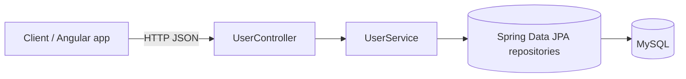

# Users Microservice

[](https://github.com/alexandra10zam/users-microservices-/actions/workflows/ci.yml)


A REST microservice that manages the **users** of a Twitter-style social app. It is built with **Spring Boot 3, Spring Data JPA and MySQL**, covered by **unit tests (Mockito) and integration tests (MockMvc + real MySQL)**, and shipped as a **Docker image** with a **GitHub Actions** pipeline.

A companion Angular frontend is in progress in [Twitter-App-Full](https://github.com/alexandra10zam/Twitter-App-Full).

---

## Architecture



| Layer | Package | Responsibility |
|---|---|---|
| Controller | `controller` | REST endpoints, HTTP status mapping |
| DTO | `dto` | API contract (`UserDTO`); entities are never exposed directly |
| Service | `service` | Business logic for users, posts, comments, likes |
| Repository | `repo` | Spring Data JPA interfaces |
| Entity | `entity` | JPA model: `User` 1-N `Post` 1-N `Comment` / `Like` |

## REST API

Base path: `/users`

| Method | Endpoint | Description | Responses |
|---|---|---|---|
| `POST` | `/users/add` | Create a user (JSON body: `firstName`, `lastName`, `email`, `password`) | `201`, `500` |
| `GET` | `/users/getUsers` | List all users | `200`, `204` |
| `GET` | `/users/getMeTheUser?email=&password=` | Look up a user's id by credentials | `201`, `404` |
| `PUT` | `/users/update?email=&password=` | Update a user | `200`, `400`, `404`, `500` |
| `DELETE` | `/users/delete?email=&password=` | Delete a user | `200`, `204`, `404` |

Example:

```bash
curl -X POST http://localhost:8080/users/add \
  -H "Content-Type: application/json" \
  -d '{"firstName":"Ada","lastName":"Lovelace","email":"ada@example.com","password":"secret"}'
```

## Run it

**Option 1: Docker Compose (app + MySQL, nothing else to install)**

```bash
docker compose up --build
# API on http://localhost:8080
```

**Option 2: Locally with Maven**

```bash
# needs a MySQL instance with a database called "twiter"
./mvnw spring-boot:run
```

The connection settings can be overridden with the standard Spring environment variables `SPRING_DATASOURCE_URL`, `SPRING_DATASOURCE_USERNAME` and `SPRING_DATASOURCE_PASSWORD`.

## Tests & CI

```bash
./mvnw verify      # unit + integration tests + JaCoCo coverage report
```

- **Unit tests** (`UserServiceTest`) mock the repository layer with Mockito.
- **Integration tests** (`UserIntegrationTest`) start the full Spring context and hit the endpoints through MockMvc against a real MySQL database.
- **GitHub Actions** ([`ci.yml`](.github/workflows/ci.yml)):
  1. builds with JDK 17, runs every test against a MySQL 8 service container, and uploads the JaCoCo coverage report as an artifact;
  2. builds the Docker image, starts the full stack with Docker Compose, and smoke-tests the live API.

## Tech stack

Java 17 · Spring Boot 3.1 (Web, Data JPA) · Hibernate · MySQL 8 · JUnit 5 · Mockito · MockMvc · JaCoCo · Maven · Docker (multi-stage, non-root) · Docker Compose · GitHub Actions

## Roadmap

These are known limitations of the current version and the planned next steps:

- [ ] **Security:** hash passwords with BCrypt, add Spring Security + JWT, and stop sending credentials as query parameters
- [ ] Rename the endpoints to resource-style REST (`POST /users`, `GET /users/{id}`, …)
- [ ] Add request validation (`@Valid`) and a global `@ControllerAdvice` error handler
- [ ] Expose posts, comments and likes through their own controllers
- [ ] Replace `ddl-auto=update` with Flyway/Liquibase migrations
- [ ] Use Testcontainers for integration tests
